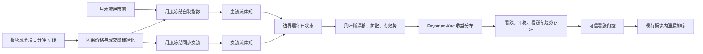

# BoundaryFlowFK 设计

## 1. 状态

本文档定义 `BoundaryFlowFK` v1。它是 DeepStock Lab 中一个新的独立研究策略，不替换、不修改现有 BNHMM、HoloBNHMM、FKStock 或 SectorFlowBayes。

设计目标已经确认，本文档用于约束后续实现。本文档不代表模型已经具有交易价值。

## 2. 目标

将板块全部成分股的一分钟价格和成交量压缩为少量有物理意义的板块流动状态，再使用低参数贝叶斯状态空间模型估计下一交易日指数收益的漂移、扩散和趋势传播阻力，最后通过 Feynman-Kac 路径期望输出：

- 下一交易日板块指数开盘到收盘的收益后验分布；
- 看跌、平稳、看涨三种状态的概率；
- 当前趋势的存活概率；
- 各板块支流对指数漂移的贡献；
- 是否允许第二层板块内强股选择。

核心原则：

1. 不把板块状态当作图像识别问题。
2. 不使用 CNN、Transformer、神经算子或高维黑盒编码器。
3. 不直接平均全部股票和全部分钟。
4. 价格和成交量承担不同职责：价格提供速度，成交量提供密度和观测可信度。
5. 所有估计必须因果，所有月度参数必须冻结。
6. 没有通过消融验证的变量不得进入最终模型。

## 3. 非目标

v1 不包含：

- 新闻、政策、财务或宏观数据；
- 跨板块联合训练；
- 次日未知分钟状态的神经网络生成；
- 高频盘口、逐笔成交方向或订单簿；
- 日内实时调仓；
- 做空；
- 自动发布到 Quant Platform；
- 以准确率作为唯一晋级指标。

## 4. 总体结构

系统分为三层，职责不得混合：

1. `BoundaryFieldExtractor`：只负责将分钟板块数据压缩为流体矩和边界层状态。
2. `BayesianBoundaryStateModel`：只负责估计漂移、扩散和有效势的后验。
3. `FeynmanKacForecaster`：只负责从后验参数计算收益分布和趋势存活概率。

## 5. 数据与时间定义

### 5.1 输入

- 板块全部可用成分股的一分钟 OHLCV；
- 板块成分定义；
- 成分股日线中的流通市值；
- 可选的真实 `881121` 日线，仅用于结果页外部基准比较，不参与训练和标签。

每个板块独立拟合。半导体实验使用数据集 `semiconductor`。请求区间内完全没有一分钟线的成分股先从板块中剔除；145 当前 100 个成分股中有 96 个至少存在一分钟线。

模型指数由剩余成分股因果构造，不再依赖 `881121` 一分钟线。指数权重只使用上月末已经公布的正流通市值，整月冻结；禁止使用当月末市值、未来成分和日线收益拟合分钟权重。没有上月末有效市值的股票当月不进入指数，不能静默改成等权。

### 5.2 信号与标签

- `signal_time`：交易日收盘后，最后一根有效一分钟线的时间；
- `available_at`：下一交易日第一根可交易一分钟线；
- `target_time`：下一交易日最后一根有效一分钟线；
- 目标收益：下一交易日自制指数开盘到收盘的对数收益；
- 训练样本只有在 `target_time <= training_cutoff` 时才成熟。

模型不得读取下一交易日开盘、成交量或分钟状态来生成前一日信号。

### 5.3 缺失数据

- 午休、停牌和缺失分钟保留为空；
- 不跨午休插值；
- 不用零收益填充停牌；
- 单股缺失不丢弃整个交易日；
- 低于最小有效股票比例的交易日不生成状态。

## 6. 因果标准化

### 6.1 价格速度

股票 `i` 在分钟 `t` 的原始速度：

\[
r_{i,t}=\log P_{i,t}-\log P_{i,t-1}
\]

跨午休、跨日和缺失分钟不计算相邻速度。

标准化速度仅用于比较股票之间的同步、湍流和边界厚度：

\[
z_{i,t}=\frac{r_{i,t}}{s_{i,d}+\epsilon}
\]

`s_{i,d}` 是交易日 `d` 之前 10 个完整交易日的一分钟收益 RMS。原始 `r` 保留给指数收益和真实流速计算，不能用 `z` 代替指数收益。

### 6.2 相对成交量密度

\[
\rho_{i,t}=\frac{V_{i,t}}{\bar V_{i,d}/240+\epsilon}
\]

`\bar V_{i,d}` 是交易日 `d` 之前 10 个完整交易日的平均日成交量。当天数据不进入当天基准。

相对成交量不定义速度，也不承担价格方向。它只作为质量密度、参与强度和观测权重。

## 7. 月度冻结自制指数

### 7.1 两套权重

模型必须区分：

- `w_i`：股票对自制板块指数价格变化的贡献；
- `rho_i`：当前分钟的成交参与密度。

两者不得相互替代。

### 7.2 权重来源

股票 `i` 在月份 `m` 的指数权重使用月份开始前最后一个已完成交易日的流通市值：

\[
w_{i,m}=\frac{\operatorname{circ\_mv}_{i,t_m^-}}{\sum_j\operatorname{circ\_mv}_{j,t_m^-}}
\]

只有在请求区间内存在一分钟线、且在 `t_m^-` 已存在正流通市值的股票才参与月份 `m`。权重每月生成一次并冻结整月。制品必须记录权重日期、训练截止时间、纳入与剔除股票、有效股票数和集中度。

### 7.3 自制指数分钟速度

\[
v_{I,t}=\frac{\sum_{i\in A_t}w_{i,m}r_{i,t}}{\sum_{i\in A_t}w_{i,m}}
\]

`A_t` 是分钟 `t` 有有效相邻价格的当月指数成员。缺失、停牌和跨午休收益不填零；仅在有效成员权重和与成员比例都达到配置门槛时生成指数速度。每日开盘到收盘收益使用相同月度权重和同时具备当日有效开盘、收盘的成员计算。真实 `881121` 日线只作为外部基准，不进入模型。

## 8. 主流流体矩

定义成交参与权重：

\[
p_{i,t}=\frac{w_i\rho_{i,t}}{\sum_j w_j\rho_{j,t}+\epsilon}
\]

每分钟计算以下状态。

### 8.1 水量、动量和流速

\[
M_t=\sum_i w_i\rho_{i,t}
\]

\[
J_t=\sum_i w_i\rho_{i,t}r_{i,t}
\]

\[
u_t=\frac{J_t}{M_t+\epsilon}
\]

`M` 是参与水量，`J` 是成交支持的价格动量，`u` 与指数速度具有相同收益单位。

### 8.2 方向一致性

\[
C_t=\frac{|\sum_i p_{i,t}z_{i,t}|}{\sum_i p_{i,t}|z_{i,t}|+\epsilon}
\]

`C` 位于 `[0,1]`。接近 1 表示成交参与者方向一致，接近 0 表示内部对冲。

### 8.3 湍流

\[
\bar z_t=\sum_i p_{i,t}z_{i,t}
\]

\[
T_t=\sum_i p_{i,t}(z_{i,t}-\bar z_t)^2
\]

`T` 表示板块内部标准化速度分歧。

### 8.4 参与广度与集中度

\[
B_t=\sum_i p_{i,t}\operatorname{sign}(z_{i,t})
\]

\[
H_t=\sum_i p_{i,t}^2,\qquad N_{eff,t}=1/(H_t+\epsilon)
\]

`B` 表示上涨与下跌成交参与的净广度，`H` 表示成交是否集中在少数股票。

### 8.5 指数脱节

\[
D_t=\frac{v_{I,t}-u_t}{s_{I,d}+\epsilon}
\]

`s_{I,d}` 是过去 10 个完整交易日的指数一分钟收益 RMS。

- `D > 0`：指数上涨速度超过成交支持的水流速度；
- `D < 0`：成交支持的水流强于指数当前表现；
- `|D|` 持续扩大：指数与板块真实参与正在脱节。

### 8.6 边界层厚度

\[
\delta_t=\frac{\sqrt{T_t}}{|\bar z_t|+q_{0.25}(|\bar z|)+\epsilon}
\]

分母中的分位数只使用训练窗口历史，并在每折冻结，防止主流接近零时数值爆炸。

同时保留：

- `delta_slope`：过去 30 分钟稳健线性斜率；
- `delta_acceleration` 不进入 v1，避免噪声放大。

### 8.7 有效黏性

定义个股对主流的残差：

\[
e_{i,t}=z_{i,t}-\bar z_t
\]

在过去 60 个有效分钟上做带权 AR(1) 回归：

\[
e_{i,t+1}=\phi_t e_{i,t}+\eta_{i,t}
\]

定义：

\[
\nu_t=\operatorname{clip}(1-\phi_t,0,2)
\]

`nu` 越高，个股偏离后越快回到板块主流；`nu` 越低，分歧越持久。回归只使用当前分钟及之前已经发生的转移。

## 9. 月度固定支流

复用 SectorFlow 已有的 60 日因果同步拓扑。每月开盘前根据历史数据将股票分成固定支流，整月不得重排。

v1 默认支流数为 4，可配置范围为 3 至 5。若稳定聚类不足 3 组，该月只输出主流模型并标记 `branch_degraded=true`，不得人工复制支流。

每条支流 `g` 计算：

\[
M_{g,t},\quad J_{g,t},\quad u_{g,t},\quad C_{g,t},\quad T_{g,t}
\]

支流对主流的贡献：

\[
Q_{g,t}=\frac{J_{g,t}}{\sum_h |J_{h,t}|+\epsilon}
\]

模型保留固定顺序的支流贡献、最大正向支流、最大反向支流以及支流流速方差。它们用于区分“全板块共振”和“少数支流拉动指数”。

## 10. 每日边界层状态

v1 不生成下一日未知的分钟状态图。每个交易日收盘后，将已经发生的 240 分钟流体矩压缩为每日状态 `S_d`。

对主流变量保留：

- 最后 30 分钟成交加权均值；
- 最后 60 分钟成交加权均值；
- 全天时间积分；
- 全天二次变差；
- 高一致性占用时间；
- 高湍流占用时间；
- 收盘值。

支流只保留：

- 收盘贡献 `Q_g`；
- 全天累计贡献；
- 最后 60 分钟一致性。

最终设计矩阵不得超过 36 列。所有列必须有明确名称和单位，禁止自动生成无名称嵌入。

## 11. 贝叶斯状态模型

### 11.1 漂移

下一交易日指数开盘到收盘收益 `R_{d+1}`：

\[
R_{d+1}=\mu_d+\sigma_d\epsilon_{d+1}
\]

\[
\mu_d=\beta^T\Phi(S_d)
\]

`Phi` 只包含主流速度、动量、一致性、脱节、边界层厚度、边界层斜率和支流贡献。系数使用零均值高斯收缩先验。

### 11.2 扩散

\[
\log \sigma_d^2=\gamma^T\Psi(S_d)
\]

`Psi` 只包含湍流、边界层厚度、脱节绝对值、低一致性、成交集中度和历史指数波动。

### 11.3 有效势

有效势不是方向概率，而是当前水势在下一交易日失效的风险。

当前方向由最后 60 分钟成交支持动量 `J` 决定。只有方向显著时才生成趋势存活标签：

方向显著定义为最后 60 分钟累计 `J` 的绝对值超过训练窗口同类统计量标准差的 `0.25` 倍。该倍数作为 `flow_direction_threshold_sigma` 暴露，默认 `0.25`，并在每折冻结。

- 下一交易日收益方向与当前 `J` 一致，且绝对收益超过动态平稳阈值：存活；
- 方向相反或落入平稳区间：失效。

\[
V_d=\operatorname{softplus}(\theta^T\Chi(S_d))
\]

\[
P(\text{survival}|S_d)=\exp(-V_d)
\]

`Chi` 只包含边界层厚度、增厚速度、湍流、脱节、一致性和有效黏性。使用贝叶斯二项回归的 Laplace 后验。

### 11.4 推断方法

- 漂移：共轭贝叶斯线性回归；
- 扩散：带高斯先验的低维对数方差回归，使用 Laplace 近似；
- 有效势：低维二项回归，使用 Laplace 近似；
- 所有特征在训练折内标准化并冻结；
- 不安装 PyMC，不引入新的深度学习依赖。

## 12. Feynman-Kac 预测

v1 将当日收盘状态视为下一交易日有效系数的后验初值。在一个交易日预测区间内，漂移、扩散和有效势分段常数。这样避免预测未知的次日分钟边界层路径。

对终端函数 `g`：

\[
U_g=E\left[\exp(-V_d)g(R_{d+1})\mid S_d\right]
\]

通过同时抽样参数后验和收益扰动计算。默认 10,000 条路径，可配置范围为 1,000 至 100,000。

模型分别输出：

1. 不含有效势权重的原始收益分布；
2. 原始看跌、平稳、看涨概率；
3. 趋势存活概率；
4. 存活权重下的方向概率；
5. 参数不确定性和收益随机性分解。

有效势不得被用来偷偷重新标定原始三分类概率。两套结果必须分别保存和展示。

## 13. 状态阈值

平稳区间使用训练截止前的指数日内收益波动：

\[
\theta_d=k\cdot\operatorname{Std}(R_{d-L:d})
\]

默认：

- `k = 0.35`；
- `L = 20` 个完整交易日；
- 最小阈值为 `0.2%`。

参数在 UI 可配置，但同一实验的全部样本外折必须使用一致定义。

## 14. 两层交易策略

第一层允许开仓必须同时满足：

- 原始看涨概率不低于 `0.55`；
- 存活权重看涨概率不低于 `0.55`；
- 趋势存活概率不低于 `0.60`；
- 看涨参数后验标准差不高于 `0.15`；
- 边界层增厚风险不处于训练样本的最高 10% 区间。

否则保持空仓。

第二层复用现有 `SourceProximityRanker` 和板块内相对强弱评分，默认选择 10 只股票等权持有。交易成本默认 10 BP。下一交易日收盘平仓，v1 不跨日持仓。

策略评估必须同时报告：

- 门控后的真实收益；
- 永远持有指数；
- 只使用第二层、不使用第一层门控；
- 随机同数量开仓；
- 交易成本前后结果。

## 15. 消融实验

实施顺序固定，每一步形成独立模型名和中文报告。

| 模型 | 输入 | 目的 |
| --- | --- | --- |
| `BFK-GBM` | 仅指数历史收益和波动 | 最低基线 |
| `BFK-Global` | 加入主流水量、动量、流速和一致性 | 验证全板块流体矩 |
| `BFK-Boundary` | 加入脱节、湍流、边界层和黏性 | 验证边界层信息 |
| `BFK-Branches` | 加入 3 至 5 条月度固定支流 | 验证局部支流贡献 |
| `BoundaryFlowFK` | 加入有效势和趋势存活 | 验证 Feynman-Kac 门控 |

晋级要求：

1. 样本外 Brier 和 Log Loss 不劣于前一级；
2. 概率校准误差不恶化；
3. 结果不能依赖单一月份；
4. 新增变量的后验不能长期收缩到零且仍被保留；
5. 门控策略在交易成本后不能只靠极少数交易日贡献全部收益。

若某一级失败，后续级别停止，不允许通过增加参数绕过失败。

## 16. Walk-forward 验证

- 每个板块独立拟合；
- 最少 120 个成熟训练日；
- 月度样本外折；
- 展开式训练窗口；
- 默认先运行 1 折诊断，再运行全部可用折；
- 权重、支流、标准化和特征阈值都必须在折内冻结；
- 相同随机种子和相同样本外月份用于全部消融模型；
- 不允许为了某个样本外月份重新选择特征。

主要评价指标：

- Log Loss；
- Brier；
- 可靠性曲线和 ECE；
- CRPS；
- 收益分布覆盖率；
- 平衡准确率和 Macro F1；
- 门控收益、最大回撤、开仓率和成本；
- 漂移、扩散和有效势后验残差；
- 概率残差自相关。

## 17. 物理一致性测试

除普通单元测试外，必须构造以下合成场景：

1. 指数上涨但成交密度很低：脱节上升，趋势存活下降。
2. 大多数股票高成交同向上涨：动量和一致性上升，漂移后验上升。
3. 指数方向不变但支流相互对冲：湍流和扩散上升。
4. 个股偏离后快速回归：有效黏性上升。
5. 边界层持续增厚：有效势上升。
6. 股票顺序变化但经济量不变：流体矩不变。
7. 删除一只停牌股票：其他股票的状态不应被清零。

## 18. 模块边界

建议新增：

- `src/bnhmm/boundary_fk/types.py`
- `src/bnhmm/boundary_fk/synthetic_index.py`
- `src/bnhmm/boundary_fk/moments.py`
- `src/bnhmm/boundary_fk/daily_state.py`
- `src/bnhmm/boundary_fk/bayesian_state.py`
- `src/bnhmm/boundary_fk/feynman_kac.py`
- `src/bnhmm/boundary_fk/policy.py`
- `src/bnhmm/boundary_fk/evaluation.py`
- `src/bnhmm/boundary_fk/pipeline.py`

复用：

- `sector_flow.panel` 的分钟对齐；
- `sector_flow.normalization` 的因果历史窗口原则；
- `sector_flow.topology` 的月度冻结同步拓扑；
- `sector_flow.ranking` 的第二层强股排序；
- 现有 DuckDB 数据源、Web JobManager、显存监控和任务删除功能。

禁止把 BoundaryFlowFK 逻辑塞进现有 `sector_flow/pipeline.py` 的单个分支中。现有 pipeline 只作为参考和共享基础设施来源。

## 19. 制品

每次实验至少生成：

- `boundary-minute-moments.npz`
- `boundary-daily-states.json`
- `synthetic-index.json`
- `branch-topologies.json`
- `boundary-model-posterior.json`
- `feynman-kac-predictions.json`
- `boundary-policy-evaluation.json`
- `boundary-ablation-report.md`
- `boundary-residual-analysis.json`
- 收益分布、校准、残差、净值和回撤图。

每条预测必须包含：

- `signal_time`；
- `available_at`；
- `target_time`；
- `training_cutoff`；
- `model_version`；
- 原始三状态概率；
- 存活权重三状态概率；
- 漂移、扩散、有效势的均值和方差；
- 主要支流贡献；
- 最终门控原因。

## 20. DeepStock Lab

策略选择新增 `BoundaryFlowFK`。配置页只展示当前模型需要的参数：

- 自制指数权重：固定使用上月末流通市值；
- 相对成交量历史：固定默认 10 日；
- 股票波动标准化历史：固定默认 10 日；
- 支流数：默认 4；
- 支流拓扑历史：默认 60 日；
- 黏性回归分钟数：默认 60；
- 最少训练日：默认 120；
- 平稳阈值 sigma：默认 0.35；
- Feynman-Kac 路径数：默认 10,000；
- 看涨、趋势存活和不确定性门槛；
- Top-K 和交易成本。

结果页显示：

- 下一日收益后验分布；
- 原始与存活权重三状态概率；
- 漂移、扩散、有效势；
- 边界层厚度、增厚速度、脱节和湍流；
- 主流及各支流贡献；
- 当前流动状态；
- 开仓或空仓的明确原因；
- 五级消融对照。

不显示大段源码，不使用图像热图冒充模型解释。

## 21. 错误处理

- 剔除无一分钟线股票后有效成分少于 3 只：任务失败并列出被剔除股票；
- 某月缺少全部上月末有效流通市值：该月失败，不允许等权静默降级；
- 某分钟有效指数成员权重或成员比例低于门槛：该分钟无效，不填零；
- 实际成熟训练样本不足：跳过该折；
- 所有折都不足：任务失败并报告所需日期范围；
- 流体矩出现 NaN 或无穷：拒绝训练；
- 后验协方差非正定：增加有限抖动后重试一次，仍失败则终止；
- Feynman-Kac 有效路径低于 99%：任务失败；
- 支流退化：允许主流模型继续，但报告中必须醒目标记。

## 22. 性能边界

- v1 不训练神经网络；
- 默认 CPU 可运行，GPU 仅用于批量路径模拟；
- 单折 10,000 条路径的预测部分目标耗时小于 30 秒；
- 月度拓扑只能计算到实际需要的最后一折，不能为单折实验预计算全部未来月份；
- 全部制品与 Quant Platform 分离保存。

## 23. 实施顺序

1. 实现无分钟线成分剔除、自制指数和流体矩，完成因果与物理一致性测试。
2. 实现月度支流和每日边界层状态，验证排列不变性和因果性。
3. 实现 `BFK-GBM` 与 `BFK-Global`，跑真实半导体单折。
4. 实现边界层和黏性，形成 `BFK-Boundary`。
5. 加入支流形成 `BFK-Branches`。
6. 实现贝叶斯有效势和 Feynman-Kac 门控，形成 `BoundaryFlowFK`。
7. 接入 CLI、制品、中文报告和 DeepStock Lab。
8. 运行同月份全消融，再运行完整 walk-forward。

每一步完成后必须先保存模型名、参数、测试和报告，才能进入下一步。

## 24. 验收标准

工程验收：

- 全部因果与物理一致性测试通过；
- 本地和 145 服务器测试通过；
- 单折和多折实验可在 UI 中启动、终止、删除和查看；
- 任务记录显存、内存、耗时和模型版本；
- 所有概率、归因和门控原因可追溯。

研究验收：

- 至少一个边界层模型在相同样本外月份的 Brier 和 Log Loss 同时优于 `BFK-GBM`；
- 输出不能塌缩为单一状态；
- 概率校准优于多数类常数预测；
- 趋势存活概率必须能区分层流与分离合成场景；
- 未达到标准时明确判定实验失败，不包装成可用策略。
