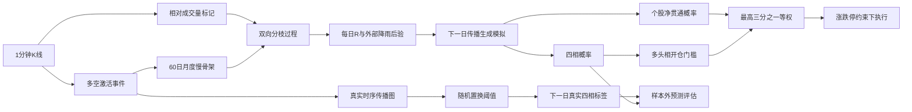

# 渗流分枝板块相变策略设计

> 日期：2026-09-06
>
> 策略名称：`PercolationBranching`
>
> 状态：设计已确认，尚未实现

## 1. 目的

本策略使用渗流相变和多类型分枝过程，预测下一交易日板块内部是否形成能够自我传播的多头或空头巨型连通结构。

模型不直接用下一日收益训练涨跌分类器。它先预测下一日传播过程和网络相态，再单独检验这些相态是否具有交易价值。

研究目标分为两层：

1. **物理目标**：预测下一日板块处于多头相、空头相、未贯通相还是多空冲突相。
2. **交易目标**：仅在多头相具有足够后验概率时，买入最可能进入多头巨型传播簇的股票。

## 2. 已确认的核心原则

- 多头传播与空头传播使用两张独立有向网络。
- 股票是节点，分钟级显著涨跌是激活事件。
- 只有前后相差 1 至 3 分钟的事件能够形成传播关系。
- 同分钟大面积共振归入外部激活，不作为股票间传播。
- 股票自身的连续涨跌单独建模，不计入板块贯通再生数。
- 传播骨架使用过去 60 个交易日构建，每月更新一次，月内固定。
- 每日只更新低维再生数与外部激活强度，不每日重估全部边。
- 下一日相态由生成式传播模拟得到，不使用分类神经网络。
- 第一版交易规则保持简单，不用复杂仓位管理美化结果。
- 新策略与现有路径效率 FK 策略隔离，二者作为独立模型对比。

## 3. 非目标

第一版明确不做以下内容：

- 不接入政策、新闻或财务数据；
- 不直接预测个股精确收益；
- 不使用 Transformer、CNN 或图神经网络；
- 不允许空头信号反向做空；
- 不做逐级减仓和峰值回撤止损；
- 不每日重排板块结构；
- 不为不同板块分别搜索最优参数；
- 不把当日同步跳涨直接解释为股票间传染。

## 4. 物理对象与符号

### 4.1 双传播网络

对包含 `N` 只股票的板块，每天维护两张网络：

- `G+`：多头传播网络；
- `G-`：空头传播网络。

有向边 `i -> j` 表示股票 `i` 的显著方向事件，会提高股票 `j` 在随后 1 至 3 分钟发生同方向事件的概率。

多头和空头传播参数独立拟合。不能用一个带正负号的矩阵替代两张网络，因为上涨扩散和下跌扩散可能具有不同的源点、速度和结构。

### 4.2 再生数

多头和空头传播矩阵分别记为 `K+`、`K-`。其最大特征值为方向再生数：

```text
R+ = rho(K+)
R- = rho(K-)
```

其中 `rho` 表示谱半径。

- `R < 1`：一个激活事件平均不能产生足够后继，扰动最终熄灭；
- `R = 1`：临界点；
- `R > 1`：传播可以自我维持，具备形成巨型传播簇的条件。

`R > 1` 是相变的动力学条件，但不是充分条件。有限股票数量、外部激活源数量和交易日长度仍会影响当天能否真正形成巨型簇。

## 5. 分钟激活事件

### 5.1 价格事件

股票 `i` 在分钟 `t` 的对数速度为：

```text
v_i(t) = log(close_i(t)) - log(close_i(t-1))
```

标准化速度为：

```text
z_i(t) = v_i(t) / sigma_i(d)
```

`sigma_i(d)` 只使用交易日 `d` 之前 10 个完整交易日的分钟速度计算，不能包含当前交易日数据。

激活事件定义为：

```text
z_i(t) >= theta    多头激活
z_i(t) <= -theta   空头激活
```

第一版建议固定 `theta = 1.5`。该值是设计默认值，不允许在样本外结果出来后反向优化。开发阶段只允许用训练区间检查事件是否过密或过稀。

停牌、无有效价格变化和数据不完整分钟不产生事件。涨跌停封板仍可产生价格事件，但其可交易性在交易执行层单独处理。

### 5.2 成交量标记

成交量不计算速度，也不决定方向。它只表示价格事件承载的参与密度。

相对成交量为：

```text
rv_i(t) = volume_i(t) / historical_volume_i(minute_of_day)
```

分母使用此前 20 个完整交易日相同日内分钟位置的平均成交量。使用相同分钟位置，是为了避免把开盘和收盘天然放量误判为异常资金密度。

事件标记为：

```text
mark_i(t) = sqrt(min(rv_i(t), 3.0))
```

平方根降低极端成交量影响，3 倍上限避免单个异常分钟支配传播估计。成交量缺失时该事件保留价格方向，但标记回退为 1，并记录数据质量标志。

## 6. 外部激活与内部传播

### 6.1 离散时间有标记分枝模型

对方向 `s`，股票 `j` 在分钟 `t` 的事件强度定义为：

```text
lambda_j^s(t)
  = mu_j^s(t)
  + self_j^s(t)
  + sum_i!=j sum_l=1..3 K_ij^s * g_l^s * event_i^s(t-l) * mark_i(t-l)
```

观测事件计数虽然只取 0 或 1，第一版仍使用稀疏离散时间 Poisson Hawkes 似然：

```text
event_j^s(t) ~ Poisson(lambda_j^s(t))
```

激活阈值使单分钟事件保持稀疏，Poisson 近似可以保留标准分枝过程的父子事件解释，并允许非负传播参数使用 Gamma 后验更新。

### 6.2 外部激活 `mu`

`mu` 表示不是由板块内其他股票传播产生的激活，至少包括：

- 股票自身长期基础事件率；
- 开盘、午后开盘和收盘的日内季节性；
- 市场同分钟共同因子；
- 板块同分钟共同因子；
- 无法由此前 1 至 3 分钟父事件解释的首次激活。

同分钟共振只进入 `mu`，不进入 `K`。这条约束用于防止一次政策或市场跳变制造大量虚假有向边。

### 6.3 自身延续 `self`

股票自身前 1 至 3 分钟的连续事件使用独立参数解释。自身延续影响个股事件预测，但：

- 不写入跨股票传播骨架；
- 不参与 `K` 的谱半径；
- 不参与板块巨型簇的跨节点连通。

### 6.4 父事件责任

一个子事件可能同时被多个父事件和外部激活解释。模型按各项强度占总强度的比例分配贝叶斯责任：

```text
responsibility(source -> child)
  = source_intensity / total_intensity
```

所有责任之和为 1，避免同一个子事件被多个父事件重复计数。该责任同时用于传播矩阵拟合和事后归因。

## 7. 月度慢传播骨架

### 7.1 候选边

每个月第一个交易日前，使用此前 60 个完整交易日生成候选传播边。

候选边构造分两步：

1. 计算股票分钟速度的共同相似度和剔除板块共同因子后的残差相似度；
2. 对每个节点保留融合相似度最高的 10 个其他节点作为候选邻居。

候选支持可以是对称的，但最终 `K_ij` 与 `K_ji` 分别估计，因此传播方向不必对称。

至少 80% 训练日具有有效分钟数据的股票才进入当月骨架。板块有效股票少于 20 只时，该月不生成相变预测。

### 7.2 稀疏贝叶斯估计

`K_ij` 必须非负。所有候选边使用分层 Gamma 收缩先验，并通过变分 EM 交替更新父事件责任和参数后验：

- 全局先验控制整个网络的稀疏程度；
- 节点先验控制源股票传播能力和接收股票敏感度；
- 边级参数只有在有足够滞后事件证据时才离开零附近。

1 至 3 分钟的滞后核 `g_1, g_2, g_3` 在每个方向全网络共享，并满足：

```text
g_l >= 0
g_1 + g_2 + g_3 = 1
```

不为每条边单独学习滞后形状，避免参数爆炸。

### 7.3 归一化

估计得到的月度基础矩阵记为 `Kbar+`、`Kbar-`。分别归一化为谱半径 1：

```text
rho(Kbar+) = 1
rho(Kbar-) = 1
```

月度矩阵只描述传播空间形状。每日传播是否临界，由每日再生数单独决定。

## 8. 每日低维临界状态

### 8.1 每日传播矩阵

方向 `s` 在交易日 `d` 的传播矩阵为：

```text
K_d^s = R_d^s * Kbar^s
R_d^s = exp(x_d^s)
```

因此：

```text
x_d^s < 0    亚临界
x_d^s = 0    临界
x_d^s > 0    超临界
```

每天只更新 `x+` 和 `x-`，而不是更新全部边。

### 8.2 局部趋势状态

为了预测次日是否跨越临界点，每个方向维护当前临界位置和移动斜率：

```text
x_(d+1) = x_d + slope_d + epsilon_d
slope_(d+1) = kappa * slope_d + eta_d
```

`epsilon`、`eta` 为贝叶斯状态噪声。`kappa` 控制临界趋势持续性。

外部激活强度使用独立的低维状态演化，不能与 `R` 合并。大量外部种子可以造成一天内广泛上涨，但不一定说明板块内部传播已进入超临界。

### 8.3 每日过滤

交易日收盘后，使用当日分钟事件完成一次贝叶斯过滤，得到：

- `R+`、`R-` 后验均值和可信区间；
- `P(R+ > 1)`、`P(R- > 1)`；
- 临界斜率后验；
- 外部激活强度；
- 内生传播事件比例；
- 主要源节点和传播边责任。

月内使用粒子过滤更新低维状态，不重新拟合月度骨架。粒子数量属于数值精度参数，不进入策略门槛搜索。

## 9. 客观相态标签

### 9.1 每日经验传播图

真实标签不能由下一日收益定义，也不能直接由模型输出的 `R` 定义，否则会形成循环验证。

对每个方向，使用固定月度候选边和真实分钟事件构建时序有向图：

- 父事件发生在子事件前 1 至 3 分钟；
- 父子股票必须不同；
- 边必须属于当月候选骨架；
- 从每个源事件沿时间递增方向计算最多可以到达多少只不同股票。

每日最大可达股票比例记为 `G+`、`G-`。

### 9.2 随机置换零假设

为了区分真实传播和偶然同时活跃，每个月开始前使用此前 60 个交易日建立因果零假设阈值。对历史中每个交易日的事件分别做随机时间置换：

- 保持每只股票当天事件总数；
- 保持多头和空头事件数量；
- 保持开盘、上午、下午和收盘的日内活跃分布；
- 打乱不同股票之间的精确先后顺序。

默认每个历史日执行 500 次置换。结果按事件密度分箱，得到不同事件密度下、无跨股票传播时最大可达比例的 95% 分位。整张阈值表在下一个月内固定。

对实际交易日或生成模拟日，先按当天事件密度选择对应分箱，再将 `G` 与该月固定阈值比较。这样真实标签和模拟标签使用同一套规则，且阈值不会读取测试月未来数据。

置换结果按板块、月份、方向和事件密度缓存，不在每次实验中重复计算。

### 9.3 四种标签

| 多头贯通 | 空头贯通 | 标签 |
|---|---|---|
| 是 | 否 | 多头相 |
| 否 | 是 | 空头相 |
| 否 | 否 | 未贯通相 |
| 是 | 是 | 多空冲突相 |

模型预测目标是下一交易日四种相态。另行记录当前相态到下一相态的转移类型，例如“未贯通转多头”或“多头延续”，但不扩大主分类数量。

## 10. 下一日生成式预测

### 10.1 后验预测过程

每日收盘后，从过滤后验中抽样下一交易日状态：

1. 抽样 `x+`、`x-` 和对应斜率；
2. 计算下一日 `R+`、`R-`；
3. 抽样下一日外部激活数量、源股票和日内发生时刻；
4. 在 `Kbar+`、`Kbar-` 上生成后继事件；
5. 按涨跌停和交易时段边界终止不可能事件；
6. 计算模拟日的 `G+`、`G-`；
7. 使用因果可用的零假设阈值判定模拟相态。

第一版默认 10,000 条后验生成路径。路径数只控制蒙特卡洛误差，不参与信号调参。

### 10.2 输出

每个信号日至少保存：

- `signal_time`；
- `available_at`；
- `target_session`；
- `training_cutoff`；
- `model_version`；
- 四种相态后验概率；
- `R+`、`R-` 后验均值、标准差和可信区间；
- 穿越临界点概率；
- 预计 `G+`、`G-`；
- 外部激活比例与内生传播比例；
- 每只股票进入多头和空头巨型簇的概率；
- 主要传播源和主要传播路径。

## 11. 交易基线

### 11.1 开仓条件

仅当以下条件同时满足，下一可交易时点开仓：

```text
P(下一日多头相) >= 0.60
P(下一日多头相) = 四类最大概率
```

第一版不增加额外 `R` 门槛、信噪比门槛或存活率门槛，避免多个高度相关门槛重复筛选。

### 11.2 选股

对股票 `i` 定义净贯通概率：

```text
score_i
  = P(i 进入下一日多头巨型簇)
  - P(i 进入下一日空头巨型簇)
```

从有效板块成分股中选择 `score` 最高的前三分之一，等权分配全部目标资金。

该分数来自下一日传播生成结果，不使用近 20 日涨幅，也不使用未来收益。

涨停导致买入失败时，未成交资金保留为现金，不临时改买排名靠后的股票。

### 11.3 平仓条件

持仓期间，只要下一日多头相概率低于 0.60，就在下一可交易时点全局平仓。以下状态均不持仓：

- 空头相概率最高；
- 未贯通相概率最高；
- 多空冲突相概率最高；
- 多头虽最高但概率不足 0.60。

第一版不减半仓、不连续计数、不做空、不设置峰值止损。

### 11.4 成交约束

- 默认交易成本 5BP；
- 信号在当日收盘后可用，不能用当日收盘前价格成交；
- 涨停封死时买不进；
- 跌停封死时卖不出；
- 涨跌停打开后，在首个可成交分钟执行；
- 未卖出股票继续保留实际仓位并承担收益；
- 交易成本压力测试固定为 10BP。

## 12. 严格样本外训练

### 12.1 时间规则

- 月度骨架只能使用月初之前完成的 60 个交易日；
- 每日状态过滤只能使用当日及此前事件；
- 下一日标签只能在下一日结束后进入训练历史；
- 信号在目标交易日开始前冻结；
- 不允许用测试区间选择激活阈值、概率门槛、骨架大小或先验强度。

### 12.2 Walk-forward

每个测试月按以下顺序执行：

1. 用此前 60 日构建月度候选骨架；
2. 使用训练截止日前成熟事件拟合月度传播形状；
3. 从当月第一天开始逐日过滤；
4. 每日收盘生成下一日预测；
5. 下一日结束后记录真实相态；
6. 月内不重估骨架，只更新低维状态；
7. 下月重新构造骨架并继续滚动。

正式报告必须覆盖完整目标区间。限制折数的快速运行只能用于功能测试，不能用于策略结论。

## 13. 对照实验

所有对照必须使用相同样本日期、成分股、交易成本和涨跌停成交约束。

### 13.1 相态预测基线

1. 永远预测样本最多的相态；
2. 用今日相态直接预测明日相态；
3. 使用训练期四状态转移矩阵预测明日相态；
4. 只使用 `R+ > 1`、`R- > 1` 判相，不做生成模拟；
5. 去掉成交量标记的价格事件模型；
6. 打乱股票分钟先后关系的负对照。

### 13.2 交易基线

1. 板块自制指数买入持有；
2. 当前路径效率 + 贝叶斯漂移 + FK 策略；
3. 相同相变信号但买入全部成分股；
4. 相同相变信号但随机选择三分之一股票；
5. 净贯通概率最高三分之一主策略。

第 3 至 5 组用于拆分收益来自板块相变择时还是个股贯通选择。

## 14. 评估指标

### 14.1 相态预测

- 四分类混淆矩阵；
- Balanced Accuracy；
- Macro F1；
- 多头相和空头相分别的 Precision、Recall；
- Brier Score；
- Log Loss；
- Expected Calibration Error；
- 四相概率可靠性曲线；
- 从未贯通到多头、未贯通到空头的转移识别率；
- 多头延续和空头延续识别率。

不能使用普通 Accuracy 作为主要指标，因为未贯通相很可能占多数。

### 14.2 物理诊断

- `R+`、`R-` 与真实 `G+`、`G-` 的关系；
- `P(R > 1)` 分组后的真实贯通率；
- 外部激活占比与内生传播占比；
- 临界斜率与次日跨越临界点概率；
- 传播源集中度；
- 最大簇规模分布；
- 随机置换假阳性率。

### 14.3 交易结果

- 成本前和成本后收益；
- 最大回撤；
- 年化波动率；
- 收益回撤比；
- 平均仓位；
- 平均换手；
- 开仓日比例；
- 涨停未买入和跌停未卖出次数；
- 收益月份集中度；
- 5BP 与 10BP 成本压力测试。

## 15. DeepStock Lab 页面

### 15.1 配置项

选择“渗流分枝”后，只显示该模型参数：

- 数据集；
- 训练与样本外区间；
- 骨架窗口，默认 60 日；
- 激活阈值，默认 1.5；
- 传播延迟，固定显示 1 至 3 分钟；
- 随机置换次数，默认 500；
- 后验生成路径数，默认 10,000；
- 多头开仓概率，默认 0.60；
- 交易成本，默认 5BP；
- 随机种子。

候选邻居数、成交量上限、状态方程和先验参数第一版不暴露给普通配置页，避免无意义调参。

### 15.2 结果标签

1. **策略评估**：主策略与全部交易基线；
2. **相变预测**：每日预测相态、真实相态和转移类型；
3. **临界后验**：`R+`、`R-`、可信区间和临界线 1；
4. **传播网络**：多空网络、源股票和主要传播路径；
5. **收益分析**：净值、回撤、仓位和换手；
6. **校准诊断**：混淆矩阵、Brier、Log Loss 和可靠性曲线；
7. **运行摘要**：数据量、有效股票、月份、失败原因和耗时。

页面默认先展示策略评估，不直接展示源码或大量底层参数。

## 16. 数据与模块边界

建议建立独立包：

```text
src/bnhmm/percolation_branching/
├── events.py
├── backbone.py
├── branching.py
├── filter.py
├── labels.py
├── simulator.py
├── policy.py
├── walk_forward.py
├── evaluation.py
└── reporting.py
```

职责如下：

- `events.py`：价格激活、成交量标记和数据质量；
- `backbone.py`：月度候选边与慢传播结构；
- `branching.py`：稀疏贝叶斯传播矩阵和责任分配；
- `filter.py`：每日 `R`、斜率和外部激活状态；
- `labels.py`：经验时序图、随机置换和四相标签；
- `simulator.py`：下一日后验传播生成；
- `policy.py`：相变开平仓与净贯通选股；
- `walk_forward.py`：严格时间滚动；
- `evaluation.py`：预测、物理与交易指标；
- `reporting.py`：JSON、图像和中文报告。

大数组使用压缩 NPZ 或 Parquet 保存到独立存储目录，元数据和实验摘要使用 JSON。缓存和模型结果不提交到 Git。

每类缓存必须包含：

- 数据集标识；
- 股票列表哈希；
- 数据源哈希；
- 参数哈希；
- 训练截止时间；
- 代码版本；
- 创建时间。

缓存键不一致时必须重建，不能静默复用旧数据。

## 17. 异常与失败处理

- 有效股票少于 20 只：该月失败，不生成预测；
- 有效训练日少于 60 日：该月失败；
- 单方向事件过少：输出不可识别状态，不强行拟合 `K`；
- 月度矩阵无法得到有限谱半径：停止该月实验并记录诊断；
- 零假设置换没有稳定阈值：该月标签不可用；
- 后验模拟有效路径不足：预测失败，不输出交易信号；
- 数据时间倒序、重复或跨交易日错误：数据构造直接失败；
- 源数据异常涨跌幅：标记并排除策略结论，不自动修补价格；
- 跌停无法卖出：保留实际持仓，禁止报告为已清仓。

所有失败必须显示具体阶段和原因，不能只返回“训练失败”。

## 18. 测试设计

### 18.1 合成物理测试

- `R < 1` 时级联规模随代数衰减；
- `R > 1` 时形成巨型簇的频率显著上升；
- `R` 穿越 1 时最大簇出现非线性变化；
- 增加外部种子但保持 `R < 1`，不能被误判为内部超临界；
- 同分钟共同冲击只提高 `mu`，不能制造滞后传播边；
- 自身连续涨跌不能抬高跨股票谱半径；
- 父事件责任总和严格为 1。

### 18.2 因果性测试

- 当前日归一化不能读取当前日结束后的整体统计量；
- 月度骨架不能读取测试月事件；
- 训练标签的目标时间必须早于或等于训练截止时间；
- 信号时间早于目标交易日；
- 改写未来数据不能改变历史预测；
- 随机置换阈值不能读取未来月份。

### 18.3 交易测试

- 多头概率不足 0.60 时不持仓；
- 多头概率最高且达到 0.60 时只选净贯通概率最高三分之一；
- 其他三相全部请求清仓；
- 涨停买入失败和跌停卖出失败正确延续；
- 5BP 成本计算一致；
- 实际权重、目标权重和换手守恒。

## 19. 开发顺序

1. 完成分钟事件和成交量标记；
2. 完成经验传播图、随机置换和四相标签；
3. 用合成数据验证亚临界、临界和超临界；
4. 完成月度双传播骨架；
5. 完成稀疏贝叶斯分枝拟合与责任归因；
6. 完成每日 `R`、斜率和外部激活过滤；
7. 完成下一日后验生成模拟；
8. 完成严格 walk-forward 相态预测；
9. 在半导体数据上完成预测基线对比；
10. 只有预测超过基线后，才实现交易层；
11. 完成 DeepStock Lab 配置与结果页；
12. 冻结参数后测试人工智能和新能源板块；
13. 输出完整中文实验报告。

## 20. 成功标准与停止条件

### 20.1 相态预测成功标准

- Balanced Accuracy、Macro F1、Log Loss 同时优于多数类基线和状态持续基线；
- 多头相和空头相均有足够样本，不能只依赖未贯通相；
- 预测概率越高，真实贯通率总体单调提高；
- `P(R > 1)` 与真实最大传播簇存在稳定正向关系；
- 打乱分钟先后关系后，预测优势消失；
- 结果不能只由少数月份贡献。

### 20.2 交易成功标准

- 5BP 成本后收益为正；
- 10BP 压力测试不过度退化；
- 相变信号策略优于相同选股下的随机相态策略；
- 净贯通选股优于随机三分之一，并说明额外换手；
- 收益不能主要由平均仓位增加解释；
- 收益回撤比优于简单买入持有；
- 半导体冻结参数后，在其他板块获得方向一致的验证证据。

### 20.3 停止条件

满足以下任一条件，应停止交易层调参并返回物理模型检查：

- 相态预测未超过状态持续基线；
- `R` 与真实巨型簇无稳定关系；
- 高置信预测没有更高真实贯通率；
- 随机置换后仍保留同等预测效果；
- 收益只能通过降低门槛或提高仓位得到；
- 不同板块必须使用完全不同参数才能盈利。

## 21. 最终数据流



## 22. 结论

`PercolationBranching` 的核心不是把渗流术语附加到涨跌分类上，而是建立一个可以被证伪的生成过程：外部激活产生种子，板块内部传播产生后继事件，再生数跨越 1 后可能形成巨型传播簇。

它用月度高维传播形状和每日低维临界状态分离结构与水势，既保留股票间传播关系，又控制参数规模。真实标签由时序传播图和随机置换定义，下一日预测由后验传播模拟产生，收益只作为最后一层外部检验。

只有在相态预测先超过多数类和状态持续基线后，交易结果才有研究意义。若物理预测本身失败，不允许继续通过门槛、仓位或止损调参制造表面收益。
